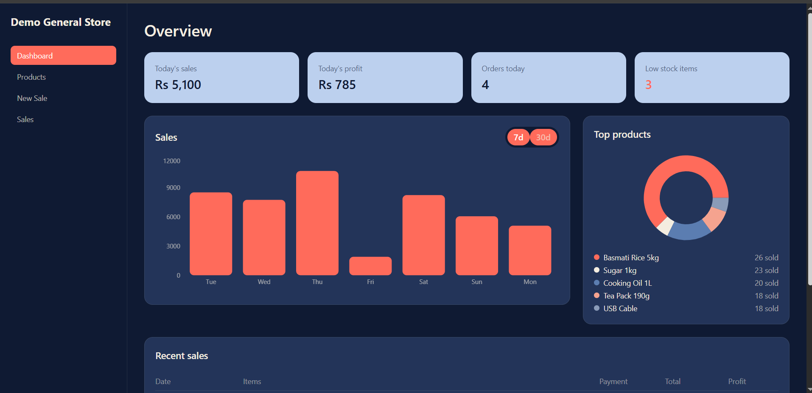
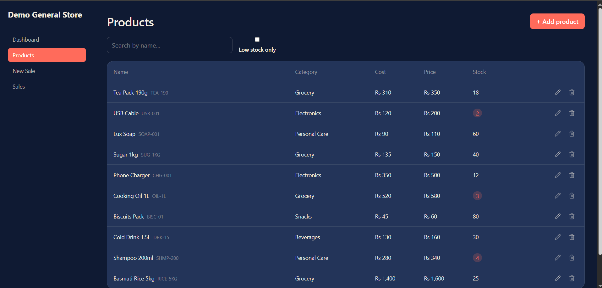
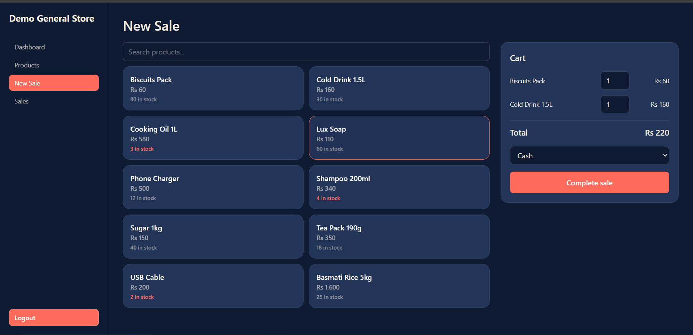
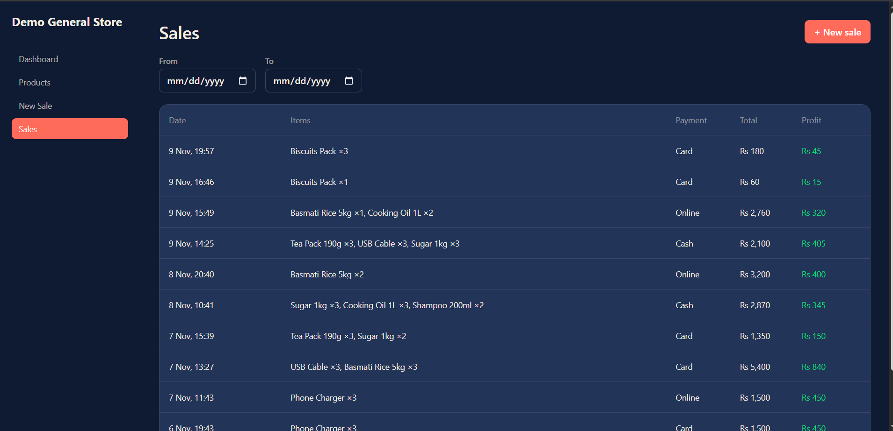
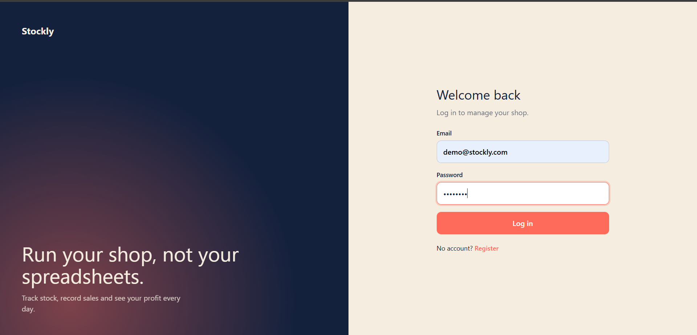

# Stockly: Inventory & Sales Tracker

A full-stack MERN app for small shops to manage products, record sales, and see daily profit at a glance. Stock is deducted automatically on every sale, and the dashboard is built from MongoDB aggregations.

**Live demo:** https://YOUR-CLIENT-URL.vercel.app
**API:** https://inventory-tracker-eight-tau.vercel.app/api/health

**Demo login**

```
Email:    demo@stockly.com
Password: demo1234
```

## Screenshots

| Dashboard | Products |
|---|---|
|  |  |

| New Sale | Sales History |
|---|---|
|  |  |



## Features

- **Authentication:** register and login with JWT, protected routes, session restore on refresh
- **Products:** add, edit, delete, search, category filter, pagination, and a low-stock filter and badge
- **Sales:** pick products into a cart, choose a payment method, and complete the sale
- **Safe stock deduction:** atomic updates prevent overselling, and a failed sale restores any stock already taken
- **Price snapshot:** each sale stores the name, price and cost at the time of sale, so later price changes never rewrite history
- **Server-side pricing:** the client sends only product ids and quantities, so prices can't be faked
- **Dashboard:** today's sales, profit, orders, low-stock count, a 7-day / 30-day sales chart, top products, and recent sales
- **Sales history:** date range filters and pagination
- **Multi-shop:** every query is scoped to the logged-in owner, so shops never see each other's data
- **Timezone-aware stats:** "today" and daily totals use Pakistan time (UTC+5), even though the server runs in UTC

## Tech stack

| Layer | Tools |
|---|---|
| Frontend | React (Vite), React Router, Tailwind CSS v4, Recharts, Axios, Lucide icons |
| Backend | Node.js, Express 5, Mongoose, JWT, bcryptjs |
| Database | MongoDB Atlas |
| Hosting | Vercel (client and serverless API) |

## Project structure

```
Inventory-tracker/
├── client/
│   └── src/
│       ├── api/axios.js           # axios instance + token and 401 interceptors
│       ├── context/AuthContext.jsx
│       ├── components/            # Layout, ProtectedRoute, AuthLayout
│       └── pages/                 # Login, Register, Dashboard, Products, NewSale, Sales
└── server/
    ├── api/index.js               # Vercel entry (exports the Express app)
    ├── vercel.json
    └── src/
        ├── app.js
        ├── server.js              # local dev only
        ├── seed.js                # demo data
        ├── lib/db.js              # cached Mongo connection for serverless
        ├── models/                # User, Product, Sale
        ├── controllers/
        ├── routes/
        └── middleware/auth.js
```

## API

All routes except `register` and `login` require `Authorization: Bearer <token>`.

| Method | Route | Description |
|---|---|---|
| POST | `/api/auth/register` | Create account, returns token |
| POST | `/api/auth/login` | Log in, returns token |
| GET | `/api/auth/me` | Current user |
| GET | `/api/products` | List with `search`, `category`, `lowStock`, `page`, `limit` |
| POST | `/api/products` | Create product |
| GET | `/api/products/:id` | Get one product |
| PUT | `/api/products/:id` | Update product |
| DELETE | `/api/products/:id` | Delete product |
| POST | `/api/sales` | Create sale (reduces stock) |
| GET | `/api/sales` | List with `from`, `to`, `page`, `limit` |
| GET | `/api/sales/:id` | Get one sale |
| GET | `/api/stats/summary` | Today's sales, profit, orders, low-stock count |
| GET | `/api/stats/daily?days=7` | Daily totals for the chart |
| GET | `/api/stats/top-products` | Top 5 products by quantity sold |

## Run locally

**Requirements:** Node.js 20+ and a MongoDB Atlas connection string.

```bash
git clone <your-repo-url>
cd Inventory-tracker
```

**Server**

```bash
cd server
npm install
```

Create `server/.env`:

```
MONGO_URI=your_atlas_connection_string
JWT_SECRET=a_long_random_string
CLIENT_URL=http://localhost:5173
```

```bash
npm run dev      # API on http://localhost:5000
npm run seed     # optional: creates the demo user, products and sales
```

**Client**

```bash
cd client
npm install
```

Create `client/.env`:

```
VITE_API_URL=http://localhost:5000/api
```

```bash
npm run dev      # app on http://localhost:5173
```

## Deploying to Vercel

Deploy `server/` and `client/` as two separate Vercel projects.

**Server project:** set `MONGO_URI`, `JWT_SECRET` and `CLIENT_URL` (the exact client URL, with no trailing slash). In Atlas, allow `0.0.0.0/0` under Network Access.

**Client project:** set `VITE_API_URL` to `https://<your-server>.vercel.app/api`, then redeploy, because Vite bakes env vars in at build time.

Notes on the serverless setup:

- The Express app is exported from `api/index.js` instead of calling `listen()`.
- `vercel.json` rewrites every path to the function and passes the original path along, and `app.js` restores it.
- The Mongoose connection is cached on `global` so cold starts don't exhaust Atlas connections.

## Concepts practiced

- JWT auth flow and protected routes (client and server)
- Mongoose schemas, relations, and indexes
- Atomic updates with `$inc` and conditional filters
- Aggregation pipelines: `$match`, `$group`, `$unwind`, `$dateToString`
- Pagination, search, and filters
- Serverless deployment details (connection caching, rewrites, CORS)

## Possible next steps

- Customer credit balances (khata)
- CSV export and printable receipts
- Staff accounts with roles
- Input validation with zod
